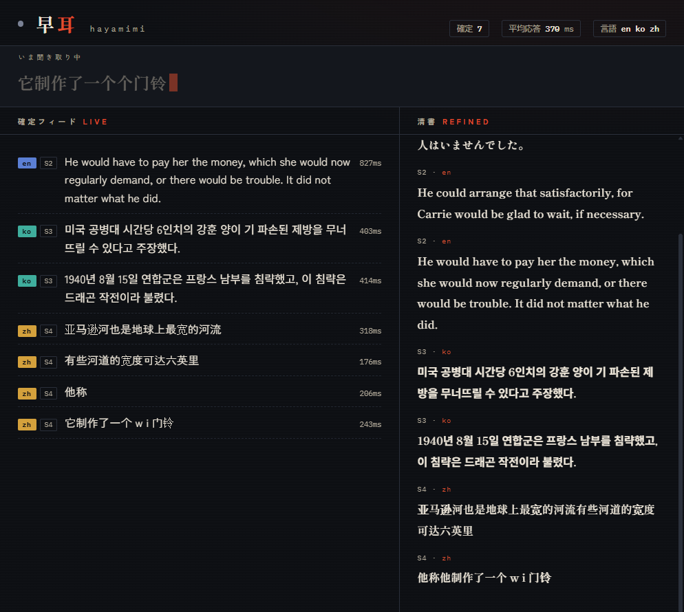
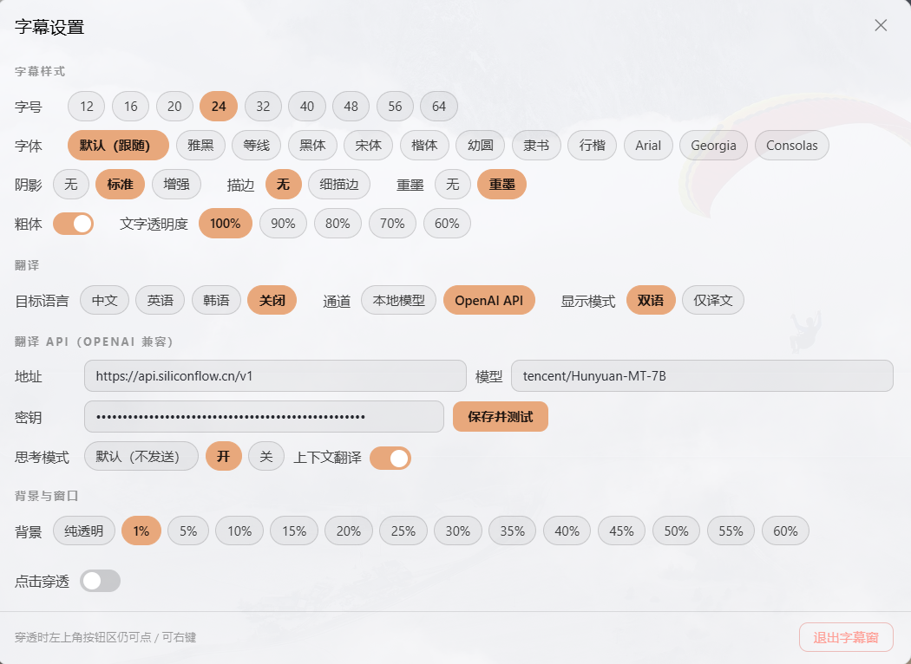

# hayamimi（早耳）

[](https://github.com/ConstantinopleMayor/hayamimi/actions/workflows/test.yml) [](LICENSE) [](https://github.com/ConstantinopleMayor/hayamimi/releases)

**纯 CPU 实时多语种语音转文字。** 实时字幕、浏览器仪表盘、说话人标签、即时翻译 —— 不需要 GPU，不依赖云端 API，内存占用低于 2GB。

"早耳"（hayamimi）在日语中意为"耳聪目明、反应快的人"。本项目的设计目标正是如此：你还在说话时，部分字幕已经出现；说完后约 **100ms** 内，确认的字幕行即落地。

English README → [README.en.md](README.en.md) / 日本語版 → [README.ja.md](README.ja.md)

## 为什么

大多数仅凭 CPU 的实时转写方案都会退而求其次采用一个通用模型（如 Whisper），并接受其准确率上限。hayamimi 则把每一段语音路由到最适合该语言的专用模型，全部以量化（INT8）ONNX 模型通过 [sherpa-onnx](https://github.com/k2-fsa/sherpa-onnx) 运行 —— 无需 PyTorch、无需 CUDA。

在真实日文广播音频上（见 `docs/SCORECARD.md`），这套路由的 **CER 为 5.8%**，不及 `whisper-large-v3-turbo` 在同样片段的 13.8%，且在 6 核桌面 CPU 上以 10-50 倍于实时的速度运行。

## 功能

| 功能 | 说明 |
|---|---|
| 5 路语言路由 | ja/zh/ko/yue 及 en+24 种欧洲语言各配专用最优模型；其余约 1600 种语言回退到 Meta Omnilingual ASR |
| 部分字幕 | 说话过程中约每 0.5s 更新一次草稿文本 |
| 快速确认 | 日语停顿时，确认行通常约 100ms 落地（其他语言见 `docs/GOALS.md`） |
| 两遍精修 | 静音 2 秒后对最近若干话语批量重新解码，产出更高精度的"清稿"（日语真实广播 CER 15.5% → 12.0%） |
| 说话人标签 | `--speakers` 用 CAM++ 说话人嵌入为每段话语标注 S1/S2/...（按话轮，非完整说话人分离） |
| 翻译 | `--translate en,zh,ko,es,...` 实时翻译识别出的行（en 走 FuguMT；其余任意 M2M-100 目标代码；zh/ko/es 已实测质量，见 `docs/TRANSLATE_M2M.md`） |
| API 翻译 | `--translate api:zh,api:en,...`（或裸 `api`）把每一行识别结果发送到 OpenAI 兼容端点（Ollama / LM Studio / OpenAI / vLLM / 硅基流动...），将**任意识别出的源语言**翻译成所选目标；桌面字幕窗的设置面板可直接填写并测试 |
| 热词/用户词典 | `--hotwords` 向解码注入专有名词偏好（当前对 ja 路由无效，见 Limitations）；`--replace` 做事后查找替换，全路由生效 |
| OBS 覆盖层 + 仪表盘 | `--serve` 启动本地 HTTP 服务器，提供浏览器源覆盖层与实时仪表盘 |
| 桌面字幕窗 | 独立 Electron 窗口：透明、置顶、可点击穿透，现代设置面板（字体/背景/翻译 API/思考模式），GitHub Release 提供便携包 |
| 网络音频输入 | `--input ws` 接受经 WebSocket 传来的麦克风音频（手机、ESP32/stackchan 等），走同一流水线 |
| 扬声器回环输入 | `--input speaker` 转写电脑正在外放的声音（WASAPI 回环，仅限 Windows）；`--input mix` 把麦克风与外放混成一路（如会议转写） |
| 内存有界 | LRU 模型淘汰策略让常驻模型保持在可配置上限内（默认总内存 <2GB） |
| 纯 CPU | 所有模型均经 sherpa-onnx 以量化 ONNX 运行；无需 GPU 或 PyTorch |

## 演示 UI

`--serve` 启动本地服务器，暴露三个视图：

- **`http://localhost:8833/dashboard`** —— 实时仪表盘：进行中语音的部分文本条、带语言徽章的确认信息流、说话人标签、每行延迟，以及两遍精修的"清稿"栏。
- **`http://localhost:8833/`** —— 供 OBS 浏览器源使用的最小覆盖层。确认行与进行中行为两行；追加 `?show=final` 或 `?show=partial` 可只渲染其中一行，方便各自独立摆放与定制。
- **`http://localhost:8833/transcript`** —— 简易滚动字幕历史。



---

## 部署

### 1. 前置条件

| 项 | 要求 |
|---|---|
| 操作系统 | **Windows 10/11**（主要开发与测试平台）；macOS/Linux 运行时均跨平台，但尚未端到端 CI 验证 |
| Python | **3.11 – 3.12（64 位）**；3.10 理论可用但未针对该版本固定依赖 |
| 磁盘 | 完整模型约 **3.1GB**；`--minimal` 精简安装约 **1.1GB** |
| 内存 | 常驻 <2GB（`--max-resident 3` 默认；`--max-resident 2` 约 1.35GB） |
| GPU | **不需要** —— 全部为量化 ONNX，CPU 推理 |
| ffmpeg | 系统中可调用（部分评测/音频工具需要；实时转写主链路不依赖） |
| Node.js | **仅桌面字幕窗的自行构建需要**；直接使用 Release 便携包时不需要 |

运行时依赖固定在 [`requirements.txt`](requirements.txt)（与开发机 venv 逐一核对过）；
评测/测试用依赖见 [`requirements-dev.txt`](requirements-dev.txt)。

### 2. 源码部署

```bash
git clone https://github.com/ConstantinopleMayor/hayamimi.git
cd hayamimi

python -m venv .venv

# Windows
.venv\Scripts\pip install -r requirements.txt
.venv\Scripts\python scripts\download_models.py

# macOS / Linux
.venv/bin/pip install -r requirements.txt
.venv/bin/python scripts/download_models.py
```

`scripts/download_models.py` 的常用选项：

| 选项 | 作用 |
|---|---|
| （无） | 完整模型集，约 3.1GB，覆盖全部路由 |
| `--minimal` | 约 1.1GB 的 ja/en 精简安装（ReazonSpeech、whisper-tiny、Silero VAD、日语标点） |
| `--en-parakeet-v2` | 加装 en-only Parakeet TDT v2（内置标点/大小写，en WER 6.6% vs v3 10.0%，约 460MB） |
| `--eval-baselines` | 评测对照模型（准确率基准用，非实时链路所需） |

**启动方式**（任选）：

```bash
# 麦克风实时转写
.venv\Scripts\python scripts\realtime_transcribe.py

# 转写电脑外放的声音（通话、视频）-- 仅限 Windows
.venv\Scripts\python scripts\realtime_transcribe.py --input speaker

# 麦克风 + 外放一起转写（如会议记录）
.venv\Scripts\python scripts\realtime_transcribe.py --input mix

# 带仪表盘 + OBS 覆盖层
.venv\Scripts\python scripts\realtime_transcribe.py --serve
# -> 浏览器打开 http://localhost:8833/dashboard
```

Windows 用户也可直接双击项目根的 **`启动早耳.bat`**：自动拉起服务器（隐藏控制台，日志写入
`%TEMP%\hayamimi-serve.log` / `hayamimi-serve.err.log`），就绪后再打开桌面字幕窗；
**`停止早耳.bat`** 一键停止。serve 日志首行是 `[build]` 标记（脚本目录 + 最新 `.py` 修改时间），
可用于确认当前运行的是哪份代码/哪次构建。

**中文路由说明**：`zh` 路由到普通话中英双语 paraformer 模型（英文按整词输出、中文数字自动还原为阿拉伯数字）；
后处理链为 CJK 数字 ITN → 标点恢复（zh 用 `punct_zh.py`，CT-Transformer int8 约 72MB）→ 用户 `--replace`。

### 3. 桌面字幕窗（便携包）

透明、始终置顶的字幕窗，把实时字幕直接渲染在桌面上 —— 无需打开 OBS。
GitHub Release 提供**独立便携包**（只含桌面窗，不含服务器/模型）：

1. 从 [GitHub Releases](https://github.com/ConstantinopleMayor/hayamimi/releases) 下载
   `hayamimi-subtitle-0.4.0-win-x64.7z`
2. **完整解压进** 源码目录的 `desktop-subtitle\`（合并，勿嵌套、勿只拷 exe；
   用 7-Zip / NanaZip 时选中该文件夹后"解压到当前文件夹"）
3. 双击 `desktop-subtitle\早耳字幕.exe`

exe 是调度器：探测 `http://127.0.0.1:8833/`，服务器没跑就自动定位项目根并拉起
（隐藏窗口，日志同上），已在运行则直接复用；**关闭字幕窗（✕ / 面板「退出字幕窗」）会
自动停止转写服务器**（只停命令行匹配 `realtime_transcribe` 的 python 进程）。

> 机器仍需 Python 3.11+ 与模型（见上一节）—— 便携包只替代 Node/Electron 部分。
> SmartScreen 提示时选"仍要运行"；压缩包若被标记为"来自网络"，可右键属性 → 解除锁定，
> 或运行 `首次运行.bat` 自动处理（该脚本同时校验包完整性）。

**自行构建**（可选，需 Node.js）：

```bash
cd desktop-subtitle
npm install
npm run dist
```

产出 `dist\hayamimi-subtitle-0.4.0-win-x64.7z`（用户分发格式）、内部 zip（整合包脚本依赖），
并自动把 exe 及相关文件平铺发布到 `desktop-subtitle\`。开发调试可用 `npm start`。

**窗内操作**


| 控件 | 作用 |
|---|---|
| 锁形图标 | 切换点击穿透（可拖拽 / 穿透） |
| 图钉图标 | 标题栏自动隐藏：未钉住＝鼠标离开后整行淡出；钉住＝常驻 |
| 齿轮图标 | 打开/关闭**设置面板**（见下） |
| EN / ZH / KO / OFF | 循环切换翻译语言 |
| 麦克风 / 喇叭 / 两者 | 循环切换音频源（切换会重启识别引擎，约 15–30 秒；系统音频仅 Windows） |
| API / 本地 | 切换翻译通道 |
| 双语 / 译文 | 切换显示模式（原文+译文 / 仅译文） |
| 顶部滑块 | 背景卡片透明度（0–60%，居中）；窗口宽度直接拖拽左右边缘 |
| `Ctrl+Alt+D` / `Ctrl+Alt+L` / `Ctrl+Alt+S` / `Ctrl+Alt+B` | 点击穿透 / 语言 / 设置面板 / 标题栏常驻 |

字幕窗默认原文、译文各显示 2 行，超出后在各自视口内向上滚动。可直接拖拽左右/上下改变尺寸：高度按整数行向下取整，拖拽优先并同步设置面板的“显示行数”；宽度变化后重新换行并保持最新内容可见。双语/仅译文也可在顶栏按钮切换。

**设置面板**（齿轮打开；**常驻置顶**，点击其他窗口不会消失；Esc / ✕ / 再点齿轮关闭）



- **字幕样式**：字号 9 档、显示行数 1–6 行（原文/译文共用）、字体 12 档（默认跟随页面）、粗体、阴影、描边、重墨（B 站弹幕式）、文字透明度
- **翻译**：目标语言、通道（本地模型 / OpenAI API）、显示模式
- **翻译 API**（OpenAI 兼容）：地址 / 模型 / 密钥 + **保存并测试**
  —— 先实测 `chat/completions`（2xx 才落盘），失败显示具体原因且不改动现有配置；
  成功后合并写入项目根 `openai_translate.json` 并热生效（服务器无需重启）
  - **思考模式**三态：默认（不发送 `enable_thinking`，兼容性最好）/ 开 / 关；
    推理模型（DeepSeek-R1 等）选"关"可显著降低延迟；不支持该参数的模型会忽略它（布尔值），
    字符串值会被严格端点拒绝（HTTP 400 code 20015）
  - **上下文翻译**开关：等价于 `context_n`（开=保留最近 6 条对照，关=0）
- **识别模型**：自动切换（whisper-tiny 判定 + SenseVoice 复核）或手动固定一个模型：
  Paraformer（中英）、ReazonSpeech（日英）、Parakeet v2（英语）、SenseVoice（中/日/英/韩/粤，
  内置标点）、Parakeet v3（欧洲 24 语）、Omnilingual（1600+ 语种）。手动时引擎只保留所选模型
  并释放其余模型与 LID（约省 1.4GB 内存），切回自动会后台重载。
  手动固定的是**模型**而不是输出语言：SenseVoice/v3/Omni 按自身判定输出语言；
  Paraformer 的中文 CER 略低于 SenseVoice（本仓库小样本 5.6% vs 7.5%），
  但标点由 CT 模型补全，SenseVoice 则自带标点——可按听感自行选择。
  Parakeet v3 / Omnilingual 的输出语言标签按文字脚本推断：拉丁语系统一按 `en`
  标记（识别文本不变，API 翻译的源语言可能显示为 en）。
  选择会写入项目根 `lid_mode.json`，重启后保持。
- **背景与窗口**：背景透明度档位、点击穿透

### 4. OBS 覆盖层

在 OBS 中添加「浏览器」源，URL 填 `http://localhost:8833/`；需要分行摆放时：

- `http://localhost:8833/?show=final` —— 只渲染确认行
- `http://localhost:8833/?show=partial` —— 只渲染进行中的草稿行

窗口尺寸按你的画面自定（覆盖层内容居中、自适应宽度）。

### 5. 翻译配置

- **本地模型**（`--translate zh` / `en` / `ko` / ...）：en 走 FuguMT（ja→en），
  其余走 M2M-100（ja→任意词表支持的目标）。仅日语源。默认**关闭翻译**。
- **OpenAI 兼容 API**（`api:` 目标）：任意源语言→目标。**推荐直接在设置面板填写并测试**；
  也可手写项目根 `openai_translate.json`（以 `openai_translate.example.json` 为模板）：

| 字段 | 说明 |
|---|---|
| `base_url` | 任意 OpenAI 兼容基址（Ollama `/v1`、LM Studio、vLLM、硅基流动...） |
| `model` | 模型名（如 `tencent/Hunyuan-MT-7B`） |
| `api_key` | 云端点必填；本地服务器留空 |
| `timeout_sec` | 单次请求超时（默认 10） |
| `targets` | 允许的 `api:` 目标，如 `["zh","en","ko"]` |
| `enable_thinking` | 可选布尔；**不写＝不发送该参数**（最兼容）。字符串值会被部分端点拒绝 |
| `context_n` | 上下文对照条数（0 关闭，默认 6） |
| `context_timeout_s` | 多久无翻译视为换话题并清空上下文（默认 60） |
| `src_names` / `prompt` | 提示词中的语言名映射 / 自定义系统提示词模板（`{src}` `{target}` 占位符） |

### 6. 常见问题

| 现象 | 处理 |
|---|---|
| 首次启动很慢 | 正常：首次加载模型约 15–30 秒（serve 日志可见 `loading models...`） |
| 端口 8833 被占用 | 换端口：`--serve 8840`；覆盖层/仪表盘 URL 随之变化。桌面窗按项目设置里配置的 URL 探测 |
| `incomplete package` / 模型缺失 | 用 `download_models.py` 补齐（`--minimal` 精简）；确认 `models/` 在项目根下 |
| 没有声音 / 选错设备 | `--list-audio-devices` 列出设备，`--mic-device NAME` / `--speaker-device NAME`（子串匹配）指定 |
| 远程桌面（RDP）里麦克风打不开 | Windows 禁止跨会话访问；在 mstsc 中开启麦克风重定向，或本机控制台运行 |
| 系统音频转写无声 | WASAPI 回环仅 Windows；确认用的是输出设备而非输入 |
| 想确认当前跑的是哪版代码 | 看 serve 日志首行 `[build] ...`（脚本目录 + 最新 .py 时间） |
| 杀软/SmartScreen 拦截 | 解压后运行 `首次运行.bat`（自动解除"来自网络"标记）；或手动解除锁定 |

---

## 网络音频输入

`--input ws` 以 WebSocket 接收端点代替本地麦克风。手机或 stackchan 类 ESP32 板可通过局域网串流麦克风音频：

```bash
.venv/Scripts/python scripts/realtime_transcribe.py --input ws --serve
# -> ws://<host>:8766/ingest 接收音频；http://localhost:8833/dashboard 显示结果
```

协议：连接 `/ingest`，发送一条 JSON 文本帧（`{"sr": 16000, "format": "pcm_s16le", "channels": 1}`），
然后以二进制帧串流原始 `pcm_s16le` 音频。服务器会重采样非 16kHz 音频，以与仪表盘 SSE 相同的
partial/final/translation/refine JSON 事件应答。同一时刻只接受一个音频生产客户端；
`scripts/ws_mic_client.py` 是无依赖参考客户端（按实时节奏串流一个 wav 文件）。

## 扬声器（系统外放）回环输入

`--input speaker` 转写电脑音频输出上正在播放的内容（通话对面、视频等）；`--input mix` 把麦克风与外放混成一路，
适合会议记录。底层是 `soundcard` 包的 WASAPI 回环：直接挂到渲染端点上，无需"立体声混音"设置。
**仅限 Windows**。`mix` 按采集时间戳对齐（约 48ms 容差）后相加并截幅，以麦克风时钟为主；
扬声器采集失败会在 stderr 报告并退化为纯麦克风。注意这是**单路混合转写**，不做分轨，
也没有回声消除——请戴耳机。

## 运行时翻译热切换（无需重启）

在**服务器运行中**改变翻译语言，两条途径：

1. **控制台命令**：`translate en,zh,ko` / `translate off` / `translate api:zh` / `quit`
2. **HTTP 端点**：`POST /api/translate`，`{"langs": "zh"}` / `{"langs": "api:zh,en"}` / `{"langs": ""}`
   —— 字幕窗的语言/通道按钮即调用此端点。

翻译器懒加载，首次切换需数秒。API 通道的配置（`openai_translate.json`）在每次热切换时
**重新读取**，因此面板保存后立即生效。

## CLI 参考

| 参数 | 默认 | 说明 |
|---|---|---|
| `--wav PATH` | 麦克风 | 从 16kHz 单声道 WAV 模拟流式输入 |
| `--no-realtime` | 关 | 搭配 `--wav` 时不按实时节奏播 |
| `--input {mic,wav,ws,speaker,mix}` | mic | 音频来源 |
| `--mic-device NAME` / `--speaker-device NAME` | 系统默认 | 设备子串匹配 |
| `--list-audio-devices` | 关 | 列出音频设备后退出 |
| `--serve [PORT]` | 关，8833 | 启动仪表盘 + OBS 覆盖层 |
| `--translate [LANGS]` | 关 | 逗号分隔目标；`api:` 前缀走 OpenAI 兼容端点 |
| `--speakers` | 关 | S1/S2/... 说话人标注 |
| `--hotwords PATH` / `--replace PATH` | 无 | 热词（ja 路由暂无效）/ 用户词典 |
| `--text-shadow` `--text-stroke` `--text-ink` `--text-opacity` `--bold` `--bg` `--mode` `--lang` `--size` | — | 字幕窗启动样式 |

完整列表见 `scripts/realtime_transcribe.py --help`。

## 架构

```
                          ┌─────────────┐
  mic / wav ───────────▶ │  Silero VAD │  0.35s 停顿时长 + 0.8s 前滚
                          └──────┬──────┘
                                 │ 语音段
                                 ▼
                   ┌───────────────────────────┐
                   │  whisper-tiny 口语语言识别  │  段仍在输入时于前 4s 运行
                   └─────────────┬─────────────┘
                                 │ 语言标签
                 ┌───────────────┼────────────────┬─────────────┬──────────────┐
                 ▼               ▼                ▼             ▼              ▼
             ┌───────┐      ┌─────────┐      ┌──────────┐  ┌─────────┐   ┌──────────┐
             │  ja   │      │   zh    │      │  ko/yue  │  │ en + 24 │   │  ~1600   │
             │ Reazon│      │Paraformer│      │SenseVoice│  │EU 语种  │   │  其他    │
             │Speech │      │   -zh   │      │  small   │  │Parakeet │   │Omnilingual│
             └───┬───┘      └────┬────┘      └────┬─────┘  └────┬────┘   └────┬─────┘
                 └───────────────┴────────────────┴─────────────┴─────────────┘
                                                │
                     partial（约每 0.5s）        │      final（停话约 0.1s）
                     ◀───────────────────────────┴───────────────────────▶
                                                │
                          ┌─────────────────────┼─────────────────────┐
                          ▼                     ▼                     ▼
                 ┌────────────────┐   ┌──────────────────┐   ┌────────────────┐
                 │ 标点恢复        │   │ 说话人标注        │   │ 翻译            │
                 │ (ja/zh restore)│   │ (CAM++, --speakers)│   │ (本地/API)      │
                 └────────────────┘   └──────────────────┘   └────────────────┘
                                                │
                      静音 2 秒：批量重解码最近话语（两遍精修）
                                                │
                                                ▼
                             仪表盘 / OBS 覆盖层 / 桌面字幕窗
```

模型首次使用时懒加载；LRU 缓存按 `--max-resident` 逐出最近最少使用的非日语模型，使内存保持有界。

## 实测性能

端到端（语言识别 → 路由 → 解码 → 标点），真实语音，无前滚/两遍精修（单片段）。
`en` 使用 WER，其余使用 CER。完整方法见 `docs/SCORECARD.md`。

| 语言 | 片段数 | 语言识别准确率 | 路由 | 平均错误率 | 平均 RTF |
|---|---|---|---|---|---|
| ja | 15 | 15/15 | ReazonSpeech | 7.5% | 0.071 |
| en | 15 | 15/15 | Parakeet v3 | 2.3% | 0.109 |
| zh | 12 | 12/12 | Paraformer-zh | 5.3% | 0.102 |
| ko | 12 | 12/12 | SenseVoice | 8.1% | 0.062 |
| yue | 12 | 12/12 | SenseVoice | 6.1% | 0.061 |

关键数字：

- **日语 CER 5.8%**（beam search）于真实广播音频，对比同片段 `whisper-large-v3-turbo` 13.8%
- **日语平均 final 延迟约 100ms**（含标点）；5 语言压力测试平均 236ms、最大 552ms
- **内存 <2GB**（`--max-resident 3`；`--max-resident 2` 约 1.35GB）
- 各路由 RTF 均远低于 0.2 —— 比实时快 9–16 倍

## 已知局限（坦诚列表）

- **不支持句内语言混码。** 路由按话语选择一种语言；句内混语会被弄乱或丢弃。
- **小段落在响铃/音效/BGM 冲击后可能误路由。** `--lang-switch-guard` + `--lid-switch-confirm` 可缓解；详见 `docs/BENCHMARKS.md` 迭代 #29。
- **会话首段先由 SenseVoice 确认语言**（`docs/NOISE.md` 双 LID 章节）；SenseVoice 5 语言之外的会话确立有短暂延迟。
- **`--hotwords` 当前对 ja 路由无效**（字节级 BPE 与 cjkchar 不兼容）；日语专有名词请用 `--replace`。
- **两个同时说话的说话人不会被分离**（按话轮标注，非真分离）。
- **本地翻译质量有上限**：FuguMT/M2M-100 为小模型，ja→zh/ko 数字不能可靠保留（见 `docs/TRANSLATE.md`、`docs/TRANSLATE_M2M.md`）。
- **端到端麦克风流水线未经本项目测试之外独立验证** —— 欢迎提交 issue。

## 许可证

源码为 MIT（`LICENSE`，copyright oboroge0）。本仓库不包含任何模型权重 ——
`scripts/download_models.py` 在安装时从其原始发布方获取，每个模型自带许可证（见 `THIRD_PARTY_NOTICES.md`）。

**有一个模型并非宽松许可**：ja->en 翻译模型（`mojicast-fugumt-ja-en-ct2`）为
**CC BY-SA 4.0**；再分发权重时须保留署名并以相同许可分发。这不影响 hayamimi 代码本身。

## 致谢

- [k2-fsa/sherpa-onnx](https://github.com/k2-fsa/sherpa-onnx) —— 所有模型运行的 ONNX 推理引擎
- [ReazonSpeech](https://research.reazon.jp/) —— 日语 ASR 模型
- [NVIDIA NeMo / Parakeet](https://huggingface.co/nvidia/parakeet-tdt-0.6b-v3) —— 英语及 24 种欧洲语言
- [Meta AI Omnilingual ASR](https://github.com/facebookresearch/omnilingual-asr) —— ~1600 种语言兜底
- [FunASR / SenseVoice](https://github.com/FunAudioLLM/SenseVoice)（阿里达摩院）—— 中文、韩语、粤语 ASR
- [Mojicast](https://github.com/ishiki-emo/mojicast)（ishiki-emo）—— 设计灵感与标点/翻译模型制品来源
- [Silero VAD](https://github.com/snakers4/silero-vad) —— 语音活动检测
- [3D-Speaker](https://github.com/modelscope/3D-Speaker)（阿里达摩院）—— CAM++ 说话人嵌入
- [Kiwi](https://github.com/bab2min/kiwipiepy) —— 韩语形态分析分词器

## 参与贡献

见 `CONTRIBUTING.md`。